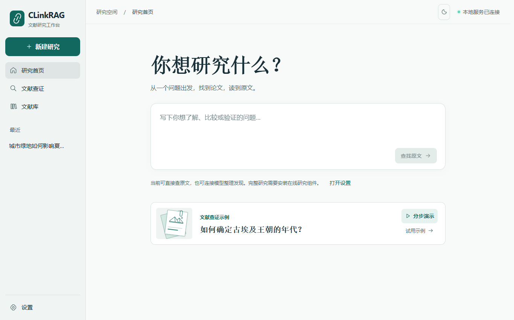
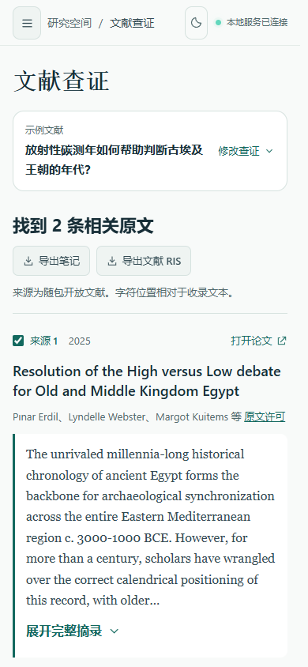

# 科研工作台使用与界面验收

## 第一次使用

第一次使用可以从首页「分步演示」开始。用古埃及王朝断代问题在本机查找论文，选中一篇后，可看到一条实际原句、它在收录文本中的位置以及论文链接。点击「在工作台打开示例」会定位到刚才选中的论文。如果想直接阅读检索结果，点击首页「试用示例」即可。

在首页填写自己的问题后，也可选择「查文献原文」。选择「我的资料」，导入可复制文字的 PDF、UTF-8 TXT 或粘贴文本。PDF 读取页码按文件实际顺序，从第一页算起。可在「修改出处」里填写标题和原始链接。结果中的「核对引用位置」显示原文位置，并在自己的材料中高亮引文。当前资料存放在页面内存，关闭页面前可导出笔记和 RIS 文献记录。



英文资料可补充英文检索词。连接模型后点击「生成英文检索词」会发送当前问题，随后可以检查并修改返回的词。选择「在线查找」时，Crossref 使用补充的英文检索词或原问题。搜索后，勾选要分析的段落，再点击「用模型整理所选原文」。页面先显示将发给模型的资料范围。每项整理出的发现保留其对应引文，可返回来源继续读。

完整研究环境中，首页输入框下方提供模型、最多分析篇数、正文长度和更多设置。研究完成后，「正文」展示研究回答，较长报告可通过正文目录跳转。点击引用编号可查看对应的文献段落。「证据与梳理」提供来源清单和可用的研究限制。



## 与上个版本相比

| 使用情境 | 上个版本 | 当前工作台 | 验证方式 |
| --- | --- | --- | --- |
| 首次使用且模型或重排组件尚未配置 | 在线研究提交不可用 | 首页展示可执行的文献查证入口，示例直接按真实问题运行 | 浏览器验证运行能力提示、实际检索端点、引用文字及论文链接 |
| 研究自己的文件 | 首页以在线论文查询为主 | 可一次加入多篇资料，按 PDF 页码过滤，编辑出处，核对引用位置 | 浏览器实际导入两页 PDF 的第 2 页、TXT 及粘贴文本，检查命中原句与页码 |
| 用中文查英文论文 | 问题和英文材料可能缺少相同术语 | 可补充或生成英文检索词，保留中文研究问题 | 浏览器模拟模型返回术语，修改后向实际个人资料检索端点发起查询 |
| 从片段整理发现 | 需发起完整在线研究 | 可选择原文、生成带出处的整理并回到该段阅读 | 浏览器检查只有勾选的资料进入整理请求，点击整理结果可定位原文 |
| 转入个人写作或文献管理 | 已有报告可导出 Markdown | 查证结果也能导出 Markdown 笔记和 RIS 记录 | 浏览器实际下载两个文件并检查内容与扩展名 |
| 阅读长报告 | 正文已有引用与独立证据面板 | 正文目录、引用、原文抽屉形成连续阅读路径 | 浏览器打开模拟历史报告，跳转至指定章节，打开引用，切换证据面板 |

## 浏览器测试

2026-11-21 使用 Microsoft Edge 验证了 1366 × 850 桌面、390 × 844 和 320 × 720 手机视口。工作台集成用例通过 63 项检查，独立的研究过程场景通过 45 项检查。两组运行均无页面脚本异常。[本轮设计与性能实测](UI_DESIGN_REVIEW.md)

用例位于 [tests/fieldwork-browser.cjs](tests/fieldwork-browser.cjs) 和 [tests/journey-scenes.cjs](tests/journey-scenes.cjs)。工作台脚本启动隔离的本地服务、临时配置和临时研究目录，自带文献、个人资料检索、PDF 提取、下载和模型设置读取均经过项目接口。模型答复、在线服务状态和研究历史使用固定数据。测试没有创建付费研究任务。研究质量的跨领域评测另见项目验收报告。

| 既有功能 | 已验证的实际页面路径 |
| --- | --- |
| 创建与控制 | 从侧栏「新建研究」返回输入框，选择自定义 14 篇，点击开始后检查提交内容与请求编号，查看过程，手动停止，再继续同一任务。任务接口返回固定状态。 |
| 设置 | 从侧栏底部进入四组设置，打开添加模型商窗口，用方向键切换到论文检索设置。 |
| 读懂关系图 | 打开模拟历史中的「论文关系图」即见相连的两篇论文。点击中间说明核对引用方向，点击论文卡片读取原句或打开来源网页。 |
| 核对深度报告 | 点击正文引用编号，在抽屉中核对引用所在段落、论文标题和本次保存的原始文本。「打开论文原网页」使用记录中的网址，只有论文编号的历史记录可跳转到对应的 Semantic Scholar 论文页。 |
| 回看研究过程 | 从已完成研究的标签页切换阶段。独立场景用例还检查有材料、缺少材料、实时追加、切换研究以及减少动效等情况。 |

在仓库根目录，使用已安装项目 Python 依赖、Node.js、Playwright 及 Edge 的环境运行：

```powershell
$env:PYTHON = (Resolve-Path .venv/Scripts/python.exe)
node tests/fieldwork-browser.cjs
node tests/journey-scenes.cjs
```

如果 Playwright 安装在仓库外，设置 `PLAYWRIGHT_MODULE` 为该模块的绝对路径。可通过 `UI_SCREENSHOTS` 指定截图目录。
