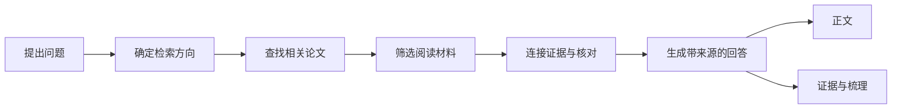

# CLinkRAG · 科学前沿导航系统

**基于检索增强生成（RAG）的论文研究工作台，从一个问题出发，查找论文、整理证据，生成可以追溯来源的回答。**

CLinkRAG 将论文检索、材料筛选、证据关系和回答生成放在同一个界面中。你既可以直接阅读研究正文，也可以查看每一步找到的材料，沿引用回到原文。项目基于 [SciRAG](https://github.com/yale-nlp/SciRAG) 扩展，当前默认入口为 **CLinkRAG 在线研究**。

[快速开始](#快速开始) · [如何使用](#如何使用) · [配置说明](#配置说明) · [常见问题](#常见问题) · [文档导航](#文档导航)

## 可以做什么

| 功能 | 使用方式 |
| --- | --- |
| 在线论文研究 | 输入问题，通过 Semantic Scholar 查找论文，核对相关性后选入分析 |
| 可视化研究过程 | 查看问题拆解、检索、筛选、连接证据、核对和生成回答的进展；按研究方向查看论文 |
| 正文与证据分开阅读 | 正文回答问题，“证据与梳理”展示来源与分析依据 |
| 论文关系图 | 从图中查看论文之间的联系，点击论文或关系查看对应材料 |
| 多服务、多模型 | 为一个模型服务配置多个模型，首页只显示在设置中保存的模型 |
| 自定义研究设置 | 调整分析论文数、回答目标长度、检索方向、补充检索与证据阅读预算 |
| 历史与继续研究 | 在侧栏打开历史记录；中断后复用已保存的检索进度继续，或永久删除记录 |



生成模型和论文检索使用外部 API；论文排序在本机运行 BGE 模型。在线研究主要依据可取得的论文摘要与片段，不能等同于已经阅读全文。

## 快速开始

以下步骤面向 **Windows 64 位 + PowerShell**。自动安装脚本使用 Python 3.12 和 CUDA 12.8 版 PyTorch；无 NVIDIA GPU 时请使用下方 CPU 安装步骤。

### 1. 准备环境

- 安装 Git 和 [uv](https://docs.astral.sh/uv/getting-started/installation/)。安装脚本会通过 uv 创建 Python 3.12 虚拟环境。
- 准备一个受支持的模型服务 API 密钥，以及 Semantic Scholar API 密钥。
- GPU 方案需要兼容 CUDA 12.8 版 PyTorch 的 NVIDIA 驱动。首次安装还需要下载 Python 依赖和 BGE 模型权重，请预留磁盘空间与内存。

```powershell
git clone --branch local https://github.com/Empiluna/CLinkRAG.git
cd CLinkRAG
```

### 2. 安装依赖

**NVIDIA GPU：**

```powershell
.\install-local.ps1
```

脚本创建 `.venv`、安装依赖，并在配置文件不存在时从示例生成 `config.local.yaml`。末尾的本地检查不会调用付费模型 API；密钥尚未填写时会显示未配置。

<details>
<summary>没有 NVIDIA GPU：使用 CPU 安装</summary>

```powershell
uv venv --python 3.12 .venv
uv pip install --python .venv\Scripts\python.exe torch==2.8.0 --index-url https://download.pytorch.org/whl/cpu
uv pip install --python .venv\Scripts\python.exe -r requirements-windows.txt
if (!(Test-Path config.local.yaml)) {
    Copy-Item config.local.example.yaml config.local.yaml
}
```

在 `config.local.yaml` 中设置：

```yaml
RERANKER_DEVICE: cpu
RERANKER_FP16: false
```

CPU 方案仍需加载完整的 BGE 排序模型，并非轻量服务器版本；速度和内存占用取决于设备与研究规模。

</details>

### 3. 配置连接并准备排序模型

编辑 `config.local.yaml`，填写模型服务和检索密钥。也可以先启动界面，在左下角“设置”中填写并保存。示例：

```yaml
LLM_PROVIDER: deepseek
DEEPSEEK_BASE_URL: https://api.deepseek.com
DEEPSEEK_API_KEY: "填写你的模型 API 密钥"
MODEL_NAME: "填写该服务实际可用的模型 ID"
S2_API_KEY: "填写你的 Semantic Scholar API 密钥"
```

保留示例文件中的其他参数。默认排序模型为 `BAAI/bge-reranker-v2-m3`；首次使用前下载权重并做一次真实排序检查：

```powershell
.\run-local.ps1 -PrepareReranker
```

此操作需要连接模型下载服务，但不调用生成模型 API。默认开启 `RERANKER_OFFLINE`，因此准备好本地权重后再发起研究。

### 4. 启动界面

```powershell
.\start-ui.ps1
```

在浏览器打开 **http://127.0.0.1:8765/**。终端按 `Ctrl+C` 停止服务；端口被占用时可运行 `.\start-ui.ps1 -Port 8766`。

## 如何使用

1. **设置模型与论文检索。** 在“设置”中添加模型商，填写接口地址和密钥。读取该服务支持的 API 模型目录并选择需要的模型，也可手动填写模型 ID；保存后首页会显示这些模型。另在“论文检索”中填写 Semantic Scholar 密钥。
2. **提出具体问题。** 在首页输入研究问题，选择模型、分析论文上限和回答目标长度。需要限定范围时，在“更多设置”中填写研究方向或调整检索参数。
3. **查看研究过程。** 研究运行时查看每一阶段的进展，切换方向阅读找到的论文；网络等待期间可以手动停止。
4. **阅读回答并检查来源。** 在“研究回答”中阅读正文，切换“证据与梳理”查看依据，也可打开“论文关系图”探索相关材料。
5. **继续已有研究。** 从侧栏打开记录。支持恢复的中断或失败记录可点击“继续研究”；删除历史记录后无法恢复。

**两个数量的含义：**“最多分析 N 篇”是进入分析的论文数量上限，既不是检索总数，也不保证一定找到 N 篇相关论文；“约 N 字”是正文长度目标，不是严格字数承诺。回答会根据问题和实际证据组织，不要求机械地按检索维度逐项展开。

## 配置说明

本地配置模板为 [config.local.example.yaml](config.local.example.yaml)，实际配置保存在 `config.local.yaml`。环境变量优先于文件设置。

| 配置项 | 作用 |
| --- | --- |
| `LLM_PROVIDER` / `MODEL_NAME` | 模型接口类型与模型 ID |
| 对应服务的 `*_BASE_URL` / `*_API_KEY` | 模型服务地址与密钥 |
| `S2_API_KEY` | Semantic Scholar 检索密钥 |
| `REQUEST_TIMEOUT` / `MAX_RETRIES` | 模型请求超时与重试参数；论文检索有独立恢复机制 |
| `RERANKER_MODEL` / `RERANKER_DEVICE` | 本地排序模型与运行设备，例如 `cpu`、`cuda:0` |
| `RERANKER_BATCH_SIZE` / `RERANKER_MAX_LENGTH` | 排序批量大小与输入长度，影响速度和内存占用 |
| `RERANKER_FP16` / `RERANKER_OFFLINE` | 半精度推理与是否仅使用本地模型文件 |

已接入 Anthropic 原生 Messages、DeepSeek、OpenAI、通义千问及自定义 OpenAI 兼容服务。模型目录和具体模型能力以所配置服务为准。多模型连接建议通过界面管理，无需手写整组配置；研究运行期间不能修改运行配置。

密钥在本机配置文件中保存，不会回传到浏览器设置列表。`config.local.yaml`、研究历史和模型缓存已由 `.gitignore` 排除，**不要将实际配置文件提交到公开仓库**。生成请求会将问题和选用的证据发送到所选模型服务，并可能产生 API 费用。

## 研究记录与中断恢复

- `results/web-runs/` 保存每次研究的参数、状态、过程事件和结果。
- 在线研究的 `online-corpus.json` 保存检索规划、已完成查询、候选论文和摘要核对进度。
- `.cache/clinkrag/` 保存可复用的研究缓存，`.cache/huggingface/` 保存模型文件。
- 在线 CLinkRAG 遇到连接中断、超时或可恢复的服务错误时会等待重试；HTTP 429 会遵循服务端的等待要求。点击“停止研究”可以终止等待。
- “继续研究”复用已保存的检索与核对结果。尚未保存的请求，以及没有独立断点的后续生成步骤，可能重新执行。

回答生成包含截断检测与续写处理；模型服务不可用或证据不足时，界面仍可能报告未完成或失败，不会将失败当成完整答案。恢复行为详见 [网络恢复](NETWORK_RECOVERY.md) 和 [回答完整性](ANSWER_COMPLETION.md)。

## 项目结构与开发检查

```text
clinkrag/                    在线研究、证据关系与回答生成
debug_ui/                   本地 Web 服务与前端界面
longans/                    长回答流程与共享模型适配
shortans/                   上游短回答实验
evaluation/                 评估工具
examples/                   示例输入与资料
tests/                      自动化检查
config.local.example.yaml   可提交的配置模板
install-local.ps1           Windows GPU 环境安装
start-ui.ps1                启动本地界面
run-local.ps1               诊断、排序模型准备与命令行入口
```

```powershell
.\run-local.ps1 -Check             # 本地依赖与配置检查，不调用付费 API
.\run-local.ps1 -Live              # 实际请求模型与检索 API，可能产生费用
.\run-local.ps1 -Test              # 运行 Python 单元测试
```

仓库同时保留原始 SciRAG 流程和本地资料实验入口。直接执行 `run-local.ps1` 会走命令行样例流程，与首页默认的在线 CLinkRAG 研究不同。

## 常见问题

| 现象 | 处理方式 |
| --- | --- |
| PowerShell 阻止执行脚本 | 可仅对本次终端执行 `Set-ExecutionPolicy -Scope Process Bypass`，然后重试 |
| CUDA 不可用 | 检查 NVIDIA 驱动和 PyTorch 安装，或按 CPU 安装步骤配置 |
| 找不到本地排序模型 | 首次执行 `run-local.ps1 -PrepareReranker`；默认离线模式不会自动下载缺失权重 |
| 排序时显存不足 | 在设置中降低排序批量大小、输入长度，或切换 CPU |
| HTTP 429 / 检索等待 | 表示检索服务限流；等待自动恢复，或停止后稍后继续，反复重启不会解除限流 |
| 模型列表为空或请求失败 | 检查接口地址、密钥、账户权限与模型 ID；服务不提供目录时手动添加 ID |
| 选入论文少于设置上限 | 上限只限制分析数量；相关性核对后可能剩下更少论文，可调整问题或检索方向 |
| 继续研究提示未找到任务 | 确认运行的是保存该记录的项目目录，且 `results/web-runs/` 中的记录未被删除 |

## 文档导航

| 文档 | 内容 |
| --- | --- |
| [本地运行](RUN_LOCAL.md) | 安装脚本、运行方式与原始命令行流程 |
| [模型设置](MODEL_SETTINGS.md) / [服务预设](PROVIDER_PRESETS.md) | 连接配置、模型商分组与多模型选择 |
| [在线研究](ONLINE_CLINKRAG.md) / [研究选项](RESEARCH_OPTIONS.md) | 检索与分析流程、参数含义 |
| [研究过程](RESEARCH_PROCESS_UI.md) / [论文关系图](PAPER_MAP_READING.md) | 可视化和阅读交互 |
| [研究历史](RESEARCH_HISTORY.md) / [网络恢复](NETWORK_RECOVERY.md) | 历史管理、停止与继续研究 |
| [回答完整性](ANSWER_COMPLETION.md) | 截断检测与后续生成 |
| [CLinkRAG 技术记录](CLINKRAG_README.md) / [流程对照](CLINKRAG_COMPARISON.md) | 早期本地资料实现、技术设计与对照实验 |
| [SciRAG 上游说明](SCIRAG_UPSTREAM.md) | 原项目介绍、实验与引用信息 |

部分专题文档按开发日期记录迭代过程，其中早期界面与默认值可能已经变化；当前入门流程以本 README 为准。

## 分支与部署状态

| 分支 | 用途 | 当前状态 |
| --- | --- | --- |
| [`local`](https://github.com/Empiluna/CLinkRAG/tree/local) | 日常开发与本地运行，仓库默认分支 | 当前使用入口 |
| [`deploy/cloudflare`](https://github.com/Empiluna/CLinkRAG/tree/deploy/cloudflare) | Cloudflare Containers 部署准备 | 已提交配置，尚未完成部署 |
| [`deploy/tencent-cloud`](https://github.com/Empiluna/CLinkRAG/tree/deploy/tencent-cloud) | 腾讯云服务器部署准备 | 已提交配置，尚未完成部署 |

部署步骤分别见 [Cloudflare 部署说明](https://github.com/Empiluna/CLinkRAG/blob/deploy/cloudflare/deploy/cloudflare/README.md) 与 [腾讯云部署说明](https://github.com/Empiluna/CLinkRAG/blob/deploy/tencent-cloud/deploy/tencent/README.md)。`clinkrag.hifuu.space` 是计划使用的域名，目前不作为已上线演示地址。

本地入口默认仅监听 `127.0.0.1`。服务器部署还需要独立配置访问控制、密钥、持久化存储和运行资源，不能直接把本地调试服务当作公共站点开放。

## 项目来源

CLinkRAG 在 [yale-nlp/SciRAG](https://github.com/yale-nlp/SciRAG) 的基础上扩展了在线研究、证据关系、可视化工作台、多模型设置与历史恢复等功能。上游项目的介绍与学术引用保留在 [SCIRAG_UPSTREAM.md](SCIRAG_UPSTREAM.md)；其中的实验结论不代表本项目新增功能已经取得相同结果。
