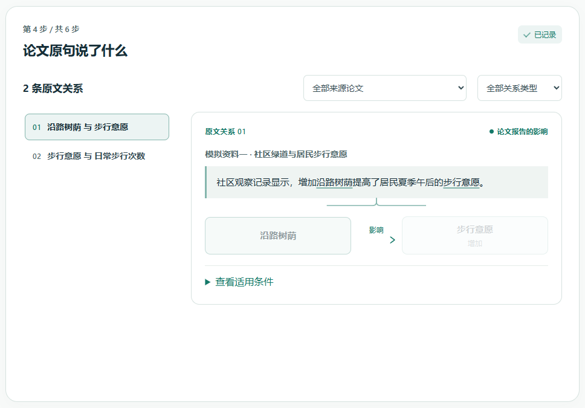
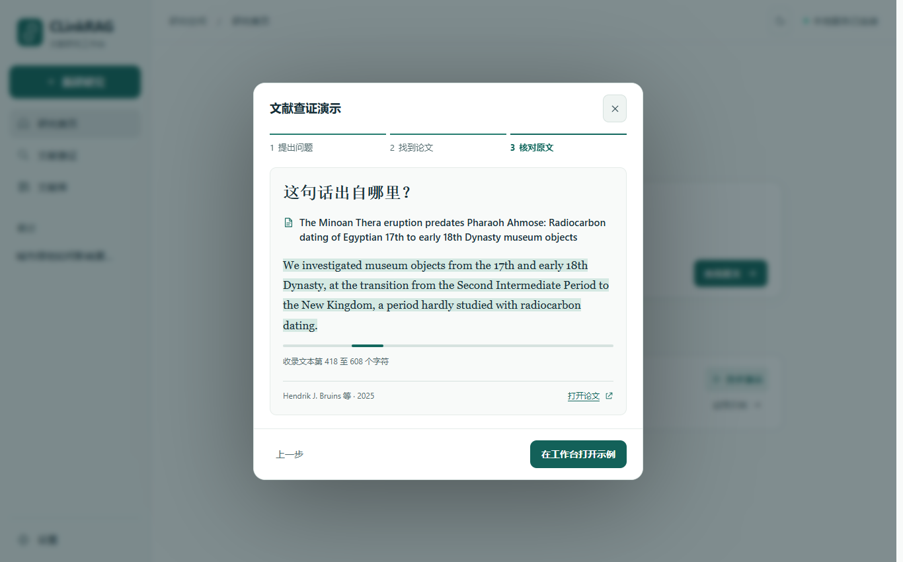

# 从问题到原文的界面改版

## 六步研究过程

上次改版后，阶段入口已经可读，但“找到 80 篇”仍无法说明哪次搜索有新发现；打开最后一步也只能分别读正文和来源。本轮先检查了六个阶段在运行、完成和资料缺失时的画面，再按三个操作重新设计：追踪一篇论文，比较两条证据，核对一处引用。

| 阶段 | 可直接在图中完成的操作 |
| --- | --- |
| 展开问题 | 沿问题分支找到对应的研究方向，展开实际检索词。 |
| 查找论文 | 跟随当前方向，看阶梯线如何随检索批次增长。选中一批，核对新增、重复数和首次出现的论文。 |
| 筛选论文 | 按候选原编号查看去向，点编号会同时定位候选和筛选结果。尚无去向记录的论文单独标明。 |
| 连接证据 | 从论文原句查看两个因素。原句里匹配的词会高亮，观察到的相关、论文报告的影响和假设分别标明。 |
| 核对条件 | 选一组证据，对照研究人群、情境、方法或中间因素的变化；每项差异都可以回看两侧原句。 |
| 形成回答 | 生成时查看送入的原文及每次保存的累计字符数。完成后选择正文中的引用位置，切换该处引用的原文，再定位回正文。 |



动图取自浏览器中的街区步行模拟案例。在首页选择「分步演示 → 查看六步研究示例」，可以自己点选全部六步。这个示例随包提供，独立于真实研究历史。

### 更新和回看

新记录进入播放队列。上一幅图的绘制结束后，页面才呈现下一件事。用户查看某条原句或切换阶段时，会停在所选位置。研究仍在运行时可点「跟随最新进展」接回。关闭动效或启用系统的减少动态效果后，图直接显示结果。完整的候选列表和原文均可键盘访问。

### 验收范围

在桌面 Edge 和 320、390、540、840 像素视口检查六个阶段，覆盖键盘、深色、减少动效、实时排队、生成续写和旧记录。长列表基准使用 240 篇固定论文、四个检索方向，在同一浏览器下比较本轮改版与提交 `041d748`。另以 300 篇单批结果验证最后一篇能打开原文。逐次性能数据与测试环境见[本轮可视化验收记录](evaluation/reports/journey-visual-validation.json)。这些用例检验数据呈现与交互；科研回答质量的实测另见[科研能力验收](WORKBENCH_ACCEPTANCE.md)。

本轮通过 75 项研究过程浏览器检查、70 项工作台检查和 119 项 Python 回归。240 篇基准中，新版三次切换方向分别为 12.1、12.2、12.2 毫秒。首次进入用时从基线的 39.3 毫秒增至 44.7 毫秒。三次最终采样中，动效结束后活动动画数均为 0。

## 上一轮工作台改版规划

在 1366 × 850 桌面和 390 × 844 手机打开旧版首页、运行内置示例、阅读检索结果，再从研究记录进入过程和关系图。桌面示例是靠右的细小文字链接。手机首次查证时，第一条结果的论文标题刚到首屏下缘。从发现回看来源会聚焦勾选框。过程页还会给滚动区以外的论文创建动画。

| 场景 | 计划 | 可检验的结果 |
| --- | --- | --- |
| 提出问题 | 保留一个输入框及框外选项，把内置案例做成可操作的文献演示 | 无密钥即可从真实问题看到论文、引文和出处，打开或退出演示均保留首页草稿 |
| 阅读文献 | 查到结果后优先留出阅读空间，给来源切换、导出和原文定位配上同一套图标 | 在手机查看完整原文，从发现到对应引句再回到阅读位置 |
| 回看研究 | 用有方向的关系图、阶段状态、增量显现解释论文如何进入研究 | 现有研究可读，重复轮询不重播，长列表保留全部内容，只给有限条目分配动画 |
| 日常使用 | 键盘、窄屏、深色主题、关闭动效与动效开启使用相同导航 | 用实际浏览器逐项验收，测交互绘制耗时、空闲动画与长任务，再根据截图修订 |

视觉沿用工作台的纸白 `#f8faf9`、正文墨色 `#182f38`、主操作墨绿 `#12685e`，搭配纸面 `#ffffff`、雾绿 `#e5f2ef` 与边线 `#d6e2df`。中文问题标题用本地宋体，交互与图表用系统无衬线字。首页的问题、输入、选项、示例共用一条左边线。演示集中呈现“选中论文后从中标出一句话”，读者控制节奏。避免给每张卡片加装饰和持续律动。

问题入口参考 [Elicit Paper Search](https://elicit.com/solutions/search)，引用回看参考 [Zotero 阅读器](https://www.zotero.org/support/pdf_reader) 与 [Ai2 的交互阅读研究](https://allenai.org/blog/case-study-iterative-design-for-skimming-support-5563dbe0899e)，图中探索关联论文参考 [ResearchRabbit](https://www.researchrabbit.ai/)。以上为交互设计参考，页面及图形均在项目内实现。

## 从第一次试用到核对出处

首页的「分步演示」会在本机实际检索示例。选中论文即可看到完整标题、可回查的英文原句、原句位置和出处。进入工作台时复用同一份结果，直接定位到选中论文。用键盘可以前进、后退和退出，首页草稿会保留。



手机查证成功后，问题和资料来源缩成一行摘要，点「修改查证」可再次编辑。长摘录可以展开。模型整理出的发现支持跳到所引那句话，读完可回到原来的发现。在 390 × 844 视口、同一个示例和相同滚动位置下，第一段原文的顶部从距页顶 910 像素提前到 562 像素。[手机截图](assets/fieldwork/mobile.png)

论文关系图用论文编号说明谁引用了谁，点击关系可以核对保存的依据，窄屏依次呈现论文、关系、相邻论文。长报告的阅读进度跟随实际滚动，跳章节会更新目录中的当前位置。进入证据页后，正文进度条随之隐藏。

## 动画与性能实测

使用 Edge 157、1366 × 850 视口，在相同的 240 篇合成论文上比较提交 `4c0f0a3` 和本轮工作树。四个检索方向各有 60 篇，首屏看到 8 张卡片。两版均运行三次。时间从触发操作计至第二次 `requestAnimationFrame` 回调，包含等待下一帧的时间。该指标用于本机比较，不能换算成所有设备的帧率。

| 指标 | 改版前 | 改版后 |
| --- | ---: | ---: |
| 进入检索时同时运行的动画 | 483 | 11 |
| 进入检索的耗时中位数 | 55.7 ms | 12.2 ms |
| 切换研究方向的耗时中位数 | 19.5 ms | 12.2 ms |
| 三次测量中超过 50 ms 的主线程任务 | 1 次，76 ms | 0 次 |
| 动画结束后仍运行的动画 | 0 | 0 |
| 开启减少动态效果后保留的论文数 | 240 | 240 |

长列表优先给当前滚动区内的条目分配动画，整份清单仍可查找、浏览。重复数据不会触发同一阶段重播。阶段状态、选中论文和引文位置在关闭动态效果后仍可辨认。[改版前的原始数据](evaluation/reports/ui-motion-before.json) · [改版后的原始数据](evaluation/reports/ui-motion-after.json)

## 实际复查与修订

第一轮截图暴露了三个问题。窄屏查询按钮的文字被旧样式隐藏，演示窗口继承了旧版的紫色主按钮，系统开启减少动态效果时弹窗背景仍在渐变。修复后又检查了 320 像素暗色视口的按钮对比度、手机首页的两列设置，以及不播放动画时的完整演示流程。最后还检查了在不同视图来回切换后，长报告仍能从 0% 读到 100%。

工作台浏览器用例通过 **63 项**，研究过程场景通过 **45 项**，项目 Python 回归通过 **119 项**。工作台用例对随包文献、导入 PDF、文本检索及导出调用实际接口；用于交互验证的深度研究记录和模型回答使用固定数据。浏览器验收没有向外部模型发送请求。在线科研能力的独立实测见[科研能力验收](WORKBENCH_ACCEPTANCE.md)。

在配有项目 Python 环境、Playwright 和 Edge 的机器上可执行以下命令。性能脚本会报告每次的原始采样；如需复测旧版，运行该脚本前把环境变量 `UI_BASE_REV` 设为 `4c0f0a3`。

```powershell
$env:PYTHON = (Resolve-Path .venv/Scripts/python.exe)
node tests/fieldwork-browser.cjs
node tests/journey-scenes.cjs
node tests/journey-performance.cjs
```
